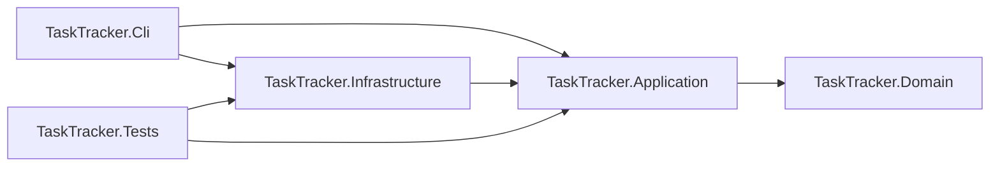

# Архітектура TaskTracker (СР3)

## 2.1. Шари

| Шар | Проєкт | Відповідальність (одне речення) | Що йому заборонено |
|---|---|---|---|
| Домен | `src/TaskTracker.Domain` | завдання, колонки, таблиця переходів, ліміти WIP, профільне правило, розрахунок завантаження й винятки домену | знати про файли, консоль, JSON, журнал і будь-який інший проєкт |
| Прикладний | `src/TaskTracker.Application` | сценарії UC-01…UC-06, барикада валідації вводу та інтерфейси сховища й годинника | знати формат зберігання і консоль |
| Інфраструктура | `src/TaskTracker.Infrastructure` | сховище JSON, умовні дані, системний годинник і журнал у файл | містити правила домену |
| Застосунок | `src/TaskTracker.Cli` | меню, читання вводу, форматування виводу та композиційний корінь | містити розрахунки й правила |
| Тести | `tests/TaskTracker.Tests` | модульні тести домену й прикладного шару з тестовими дублерами | — |

Проєкти лабораторних робіт 1–8 (`TaskTracker.Core`, `TaskTracker.App`, `TaskTracker.Tests`, `src/Legacy`,
`tests/Legacy.Tests`) лишаються в тому самому рішенні як історія курсу (рішення DR-05).

## 2.2–2.3. Правило залежностей



- **Cli → Application:** меню викликає сценарії через сервіси і не знає, як вони влаштовані всередині.
- **Cli → Infrastructure:** лише композиційний корінь створює конкретні реалізації сховища, годинника й журналу.
- **Infrastructure → Application:** `JsonBoardRepository` реалізує `ITaskRepository` та `IMemberDirectory`,
  `SystemClock` — `IClock`; інтерфейси оголошено в прикладному шарі, тож стрілка йде всередину.
- **Application → Domain:** сервіси оперують завданнями й правилами домену.
- **Domain → нікуди:** у `TaskTracker.Domain.csproj` немає жодного `ProjectReference` і жодного пакета,
  крім аналізатора StyleCop; додати `using TaskTracker.Infrastructure` у домен неможливо — проєкт не
  скомпілюється. Додатково правило перевіряють архітектурні тести `ArchitectureTests`.

## 2.4. Композиційний корінь

`src/TaskTracker.Cli/Program.cs` — єдине місце, де викликається `new` для реалізацій інтерфейсів:

```csharp
var clock = new SystemClock();
using var fileLog = new FileLoggerProvider(logPath, clock);
using ILoggerFactory logs = LoggerFactory.Create(b => b.AddProvider(fileLog));
JsonBoardRepository board = JsonBoardRepository.Open(boardPath, clock.Today);
var policy = new WipMovePolicy(WipLimits.Default);
var ui = new BoardConsole(
    new TaskService(board, board, clock, logs.CreateLogger<TaskService>()),
    new MoveService(board, policy, clock, logs.CreateLogger<MoveService>()),
    new WorkloadReportService(board, board, clock),
    new ConsoleIo(Console.In, Console.Out, Console.IsInputRedirected));
ui.Run();
```

Усі інші класи отримують залежності через конструктор. Тому заміна сховища, годинника чи правила —
це зміна одного рядка тут, а в тестах ті самі сервіси збираються з фейків (`FakeTaskRepository`,
`FakeMemberDirectory`, `FixedClock`, `SpyLogger<T>`).

## 2.5. Точки розширення

| Передбачувана зміна | Механізм | Що змінюється |
|---|---|---|
| нове правило переміщення (наприклад, «не брати Low, поки є Critical у Todo») | нова реалізація `IMovePolicy` (стратегія або декоратор над `WipMovePolicy`) | новий клас + один рядок у `Program.cs`; `BoardTask` і сервіси не змінюються |
| інші ліміти WIP чи нова дозволена стрілка між колонками | дані: екземпляр `WipLimits` і таблиця `TransitionTable` | значення в одному місці; код перевірок не змінюється |
| інший спосіб зберігання (CSV, база даних) | нова реалізація `ITaskRepository` та `IMemberDirectory` | новий клас в інфраструктурі + рядок у `Program.cs`; домен і сервіси не змінюються |
